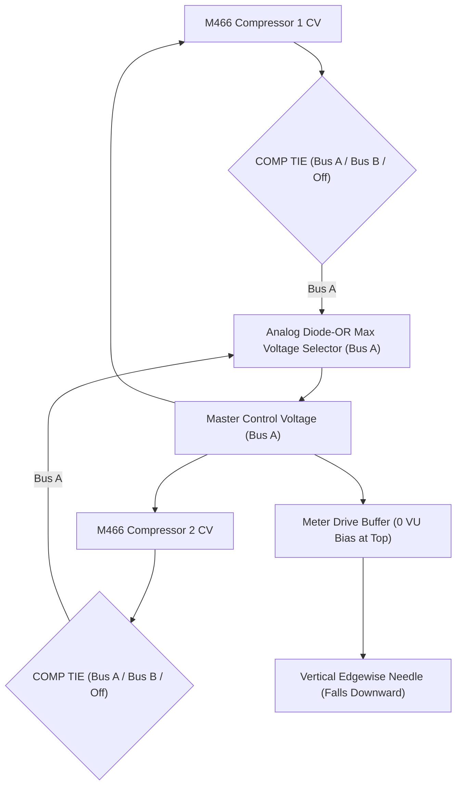

# Ward-Beck Systems M466M Compressor Meter & Bus Link Module - VST/AU Plugin Build Plan

**Module Name:** WBS M466M Compressor Meter & Multi-Channel Bus Link Module  
**Hardware Reference:** Ward-Beck Systems M466M Compressor Meter Module (Drawing Series `466-02-005`, September 1976)  
**Target Architecture:** VST3 / AU / AAX / CLAP (C++20 / JUCE 7 / Native Frame Engine)  
**Shared Engine Dependency:** [`wbs::engine::SharedPluginFrame`](file:///home/anthony/Documents/GitProjects/WBSps.ca/2030.env/vst/core/SharedPluginFrame.hpp), [`wbs::engine::VerticalEdgewiseMeterCore`](file:///home/anthony/Documents/GitProjects/WBSps.ca/2030.env/vst/core/BallisticsCore.hpp)

---

## 1. Hardware Architecture & Circuit Analysis

The **M466M** is the dedicated companion meter and bus linking module for the M466 compressor system. Because the M466 compressor card itself had no front-panel room for a physical meter, the M466M houses an **upright lit vertical edgewise meter** along with the **COMP TIE** bus switching matrix:



### Core Hardware Features
1. **Vertical Edgewise Moving Needle:**
   - Full-height illuminated edgewise movement mounted vertically.
   - Scale: $+3\text{ VU}, 0\text{ VU}, -3, -5, -7, -10, -15, -20, -\infty$.
   - **Zero-Signal Top Bias:** Biased to rest at $0\text{ VU}$ at the top with no signal reduction. When compression occurs on the linked bus, the needle deflects downward.
2. **Three-Button COMP TIE Bus Link:**
   - Pushbuttons for **BUS A**, **BUS B**, and **OFF**.
   - Links any number of M466 channels across the console backplane.
3. **Max-Detector Voting Circuit (Anti-Stereo Drift):**
   - Employs an analog diode-OR peak selector circuit: whichever linked channel detects the loudest transient generates the highest control voltage, which immediately pulls down all other tied channels equally. This guarantees that stereo imaging, center phantom vocal placement, and room balance never drift during heavy compression.

---

## 2. DSP Mathematical Specification

### 2.1 Max-Detector Control Voltage Summing
For all plugin instances sharing the same COMP TIE bus $k \in \{\text{Bus A}, \text{Bus B}\}$:
$$V_{tie,k}[n] = \max_{i \in \text{TiedInstances}} \left(V_{c,i}[n]\right)$$
This value is written to a lock-free atomic shared ring buffer or DAW sidechain bus, updating each instance's gain cell:
$$GR_{linked}[n] = V_{tie,k}[n]$$

### 2.2 Meter Ballistic Response
The vertical needle deflection follows the mass-spring mechanical damping of the edgewise movement:
$$y_{needle}[n] = b_0 \cdot \left(1.0 - \frac{GR_{linked}[n]}{20.0}\right) + b_1 x_{needle,1} - a_1 y_{needle,1} - a_2 y_{needle,2}$$

---

## 3. Parameter Mapping & State Architecture

| ID | Parameter Name | Range | Steps / Type | Default | Unit |
|---|---|---|---|---|---|
| `m466m_comp_tie` | COMP TIE Bus Assign | Off / Bus A / Bus B | 3-way Enum | Bus A | Enum |
| `m466m_meter_source`| Meter Source | Bus Master / Local Channel | Toggle | Bus Master | Enum |
| `m466m_lamp_power` | Edgewise Lamp | On / Off | Toggle | On | Bool |
| `m466m_zero_cal` | Zero Bias Trim | $-2.0$ to $+2.0$ | Continuous | $0.0$ | dB |

---

## 4. C++ Plugin Scaffolding

```cpp
#pragma once
#include "SharedPluginFrame.hpp"
#include "BallisticsCore.hpp"

namespace wbs::m466m {

class M466MPluginProcessor : public engine::SharedPluginFrame {
public:
    M466MPluginProcessor();
    ~M466MPluginProcessor() override = default;

    void prepareModule(double hostRate, double oversampledRate, size_t maxBlockSize, size_t numChannels) override;
    void releaseModule() override;
    void updateParametersFromHost() noexcept override;
    void processModuleSlice(engine::AudioBlock& slice) noexcept override;
    void updateMeters(const engine::AudioBlock& audioBlock) noexcept override;

    [[nodiscard]] float getVerticalMeterNeedlePosition() const noexcept;

private:
    engine::VerticalEdgewiseMeterCore verticalMeter_;
    uint8_t compTieBus_{ 1 }; // 0: Off, 1: Bus A, 2: Bus B
    float currentGainReductionDb_{ 0.0f };
};

} // namespace wbs::m466m
```

---

## 5. UI/UX Specification

- **Panel Format:** Narrow $1.6\text{-inch}$ channel module.
- **Visuals:** Large central edgewise meter glass window with incandescent amber backlighting, flanked by three mechanical push switches for `COMP TIE A`, `COMP TIE B`, and `RELEASE`.
