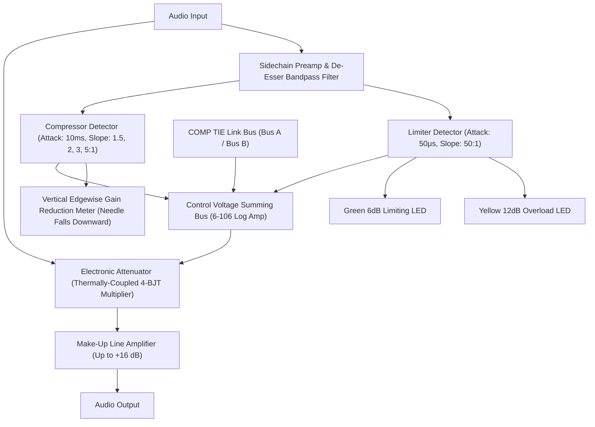

# Ward-Beck Systems M466 Compressor-Limiter - VST/AU Plugin Build Plan

**Module Name:** WBS M466 Broadcast Compressor / Limiter  
**Hardware Reference:** Ward-Beck Systems M466 Compressor-Limiter (Drawing `466-02-001`, Card 6-106, September 1976)  
**Target Architecture:** VST3 / AU / AAX / CLAP (C++20 / JUCE 7 / Native Frame Engine)  
**Shared Engine Dependency:** [`wbs::engine::SharedPluginFrame`](file:///home/anthony/Documents/GitProjects/WBSps.ca/2030.env/vst/core/SharedPluginFrame.hpp), [`wbs::engine::VerticalEdgewiseMeterCore`](file:///home/anthony/Documents/GitProjects/WBSps.ca/2030.env/vst/core/BallisticsCore.hpp), [`wbs::engine::StateVariableFilterCore`](file:///home/anthony/Documents/GitProjects/WBSps.ca/2030.env/vst/core/StateVariableCore.hpp), [`wbs::engine::NonLinearCore`](file:///home/anthony/Documents/GitProjects/WBSps.ca/2030.env/vst/core/NonLinearCore.hpp)

---

## 1. Hardware Architecture & Circuit Analysis

Introduced in September 1976 for the 460-series console frames, the **M466** represents the pinnacle of Ward-Beck's analog discrete dynamics engineering. Occupying a narrow $1.6\text{-inch}$ modular channel width, it separates compression and peak limiting into **two completely independent control paths** driving a unified, thermally coupled four-quadrant electronic multiplier:



### Core Hardware Features
1. **Separated Compressor and Limiter Circuits:**
   - **Compressor Section:** 4 selectable slopes (**$1.5:1, 2:1, 3:1, 5:1$**), smooth $10\text{ ms}$ attack, continuously variable threshold ($-30\text{ dBm}$ to $+10\text{ dBm}$), variable release ($0.1\text{ s}$ to $2.5\text{ s}$), and up to $+16\text{ dB}$ of make-up gain. Independent `COMP IN` bypass button.
   - **Limiter Section:** Fixed **$50:1$ brickwall slope**, ultrafast **$50\text{ microsecond}$ attack**, independent threshold and release, with independent `LIMIT IN` button.
2. **Dual Limiter Warning LEDs:**
   - **Green LED:** Lights at $6\text{ dB}$ of peak limiting.
   - **Yellow LED:** Lights at $12\text{ dB}$ of limiting (front panel marks this as "OVERLOAD" warning the engineer to reduce channel fader).
3. **Vertical Edgewise Gain Reduction Meter:**
   - Upright illuminated edgewise meter biased at $0\text{ VU}$ at top; needle drops downwards with compression depth.
4. **De-Esser Sidechain Tuning:** High-frequency pre-emphasis/bandpass filter in the sidechain detector path.
5. **COMP TIE Bus Linking:** Links multiple channel compressors onto Bus A or Bus B so the unit with the highest control voltage pulls down all linked channels simultaneously, preserving stereo localization.

---

## 2. DSP Mathematical Specification

### 2.1 Thermally Coupled Voltage Multiplier
The analog attenuator uses a differential transistor pair where gain is modulated by control voltage $V_c$:
$$V_{out}(t) = V_{in}(t) \cdot \exp\left(-\frac{V_c(t)}{V_T}\right)$$
In our digital model:
$$g[n] = 10^{-\frac{GR_{comp}[n] + GR_{lim}[n]}{20}}$$

### 2.2 Independent Detector Ballistics
- **Compressor Path:**
  $$v_{c,comp}[n] = v_{c,comp}[n-1] + \alpha_{att,10ms} \cdot \left(\text{max}(0, L_{in}[n] - T_{comp}) \cdot \frac{R_{comp}-1}{R_{comp}} - v_{c,comp}[n-1]\right)$$
- **Limiter Path (50 µs Attack):**
  $$\alpha_{att,lim} = 1.0 - \exp\left(-\frac{1}{0.000050 \cdot f_s}\right)$$

---

## 3. Parameter Mapping & State Architecture

| ID | Parameter Name | Range | Steps / Type | Default | Unit |
|---|---|---|---|---|---|
| `m466_comp_in` | Compressor Circuit Enable | In / Out | Toggle | In | Bool |
| `m466_comp_thresh` | Compressor Threshold | $-30.0$ to $+10.0$ | Continuous | $-10.0$ | dB |
| `m466_comp_ratio` | Compressor Ratio | 1.5:1, 2:1, 3:1, 5:1 | 4 positions | 2:1 | Enum |
| `m466_comp_release`| Compressor Release Time | $0.1$ to $2.5$ | Continuous (Log) | $0.4$ | s |
| `m466_makeup_gain` | Make-Up Gain | $0.0$ to $+16.0$ | Continuous | $0.0$ | dB |
| `m466_limit_in` | Limiter Circuit Enable | In / Out | Toggle | In | Bool |
| `m466_limit_thresh`| Limiter Threshold | $-10.0$ to $+18.0$ | Continuous | $+8.0$ | dB |
| `m466_limit_release`| Limiter Release Time | $0.05$ to $1.5$ | Continuous (Log) | $0.2$ | s |
| `m466_de_ess` | Sidechain De-Ess Filter | Off / 4 kHz / 6 kHz | 3-way Enum | Off | Enum |
| `m466_comp_tie` | Stereo Comp Tie Bus | Off / Bus A / Bus B | 3-way Enum | Off | Enum |

---

## 4. C++ Plugin Scaffolding

```cpp
#pragma once
#include "SharedPluginFrame.hpp"
#include "BallisticsCore.hpp"
#include "StateVariableCore.hpp"

namespace wbs::m466 {

class M466PluginProcessor : public engine::SharedPluginFrame {
public:
    M466PluginProcessor();
    ~M466PluginProcessor() override = default;

    void prepareModule(double hostRate, double oversampledRate, size_t maxBlockSize, size_t numChannels) override;
    void releaseModule() override;
    void updateParametersFromHost() noexcept override;
    void processModuleSlice(engine::AudioBlock& slice) noexcept override;
    void updateMeters(const engine::AudioBlock& audioBlock) noexcept override;

    [[nodiscard]] float getVerticalMeterNeedlePosition() const noexcept;
    [[nodiscard]] bool getLimiterGreenLed() const noexcept { return limit6DbActive_; }
    [[nodiscard]] bool getLimiterYellowLed() const noexcept { return limit12DbActive_; }

private:
    engine::VerticalEdgewiseMeterCore verticalMeter_;
    engine::StateVariableFilterCore sidechainFilter_[2];

    float compThresholdDb_{ -10.0f };
    float compRatio_{ 2.0f };
    float compReleaseSec_{ 0.4f };
    float makeupLinear_{ 1.0f };

    float limitThresholdDb_{ 8.0f };
    float limitReleaseSec_{ 0.2f };

    bool compIn_{ true };
    bool limitIn_{ true };

    bool limit6DbActive_{ false };
    bool limit12DbActive_{ false };
};

} // namespace wbs::m466
```

---

## 5. UI/UX Specification

- **Module Width:** Classic 460-series $1.6\text{-inch}$ vertical strip bezel.
- **Meter Layout:** Upright edgewise lit meter in upper bay with black needle on cream/amber translucent scale ($+3$ to $-\infty$).
- **Status Annunciators:** Green LED (at $6\text{ dB}$ limiting) and Yellow Warning LED (at $12\text{ dB}$ overload) placed immediately adjacent to the limiter threshold pot.
